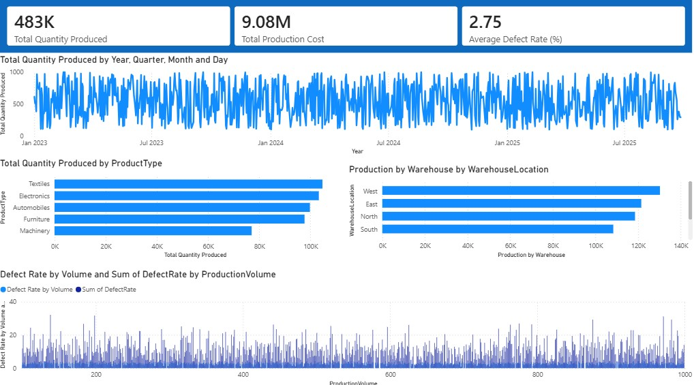

# 🏭 Strategic Manufacturing Dashboard (Power BI)

Dashboard untuk menganalisis kinerja produksi dan kualitas produk menggunakan **Microsoft Power BI**.

> Tugas praktikum mata kuliah **Kecerdasan Bisnis**
> Program Studi Sains Data, Fakultas Sains dan Teknologi, IKOPIN University (2026)
> Dosen Pengampu: Agus Nugraha, ST., M.Kom.
> Disusun oleh: **Sagara Andi Ladzuardi Suwarsa** (2C2220004)

---

## 🖼️ Tampilan Dashboard

| KPI | Nilai |
|---|---|
| Total Quantity Produced | ± 483 ribu unit |
| Total Production Cost | ± 9,08 juta |
| Average Defect Rate | 2,75 % |

---

## 📌 Latar Belakang

Data produksi dan kualitas di industri manufaktur sering tersimpan sebagai data mentah dari berbagai sumber dengan format yang berbeda. Proyek ini mengolah data tersebut menjadi dashboard untuk menjawab:

1. Bagaimana tren produksi dari waktu ke waktu?
2. Produk dan wilayah mana yang berkontribusi terbesar?
3. Bagaimana hubungan volume produksi dengan tingkat kecacatan?
4. Faktor apa yang perlu diperhatikan untuk meningkatkan efisiensi dan kualitas?

---

## 🔄 Alur Pengerjaan

1. **Import data** (Excel/CSV) ke Power BI
2. **ETL & cleaning** di Power Query: ubah tipe data, hapus kolom tidak relevan, tambah kolom waktu (Day, Month Name, Year)
3. **Data modeling**: relationship antar tabel melalui `ProductionCost` (one-to-one, cross-filter both)
4. **DAX measures** untuk KPI: total produksi, total biaya, rata-rata defect rate, downtime, quality score, dan produktivitas pekerja
5. **Visualisasi** Strategic Manufacturing Dashboard

---

## 💡 Insight Utama

1. **Produksi keseluruhan**: ± 483 ribu unit dengan biaya ± 9,08 juta, menunjukkan aktivitas operasional yang tinggi.
2. **Tren produksi**: berfluktuasi dari awal 2023 sampai akhir 2025, tetapi tetap dalam rentang yang relatif stabil.
3. **Kinerja produk**: *Textiles* tertinggi, diikuti *Electronics* dan *Automobiles*; *Machinery* terendah.
4. **Distribusi wilayah**: gudang **West** berkontribusi terbesar, **South** terendah.
5. **Kecacatan**: ada lonjakan defect rate pada volume produksi tertentu, sehingga kenaikan volume tidak selalu sejalan dengan kualitas. Pengendalian kualitas perlu diperketat pada periode produksi tinggi.

---

## ⚠️ Catatan

Kedua dataset berasal dari sumber berbeda dan dihubungkan lewat kolom `ProductionCost`, yang bukan kunci unik sejati. Analisis lintas dataset bersifat eksploratif, bukan bukti sebab-akibat.

---

## 📂 Isi Repository

| Folder | Isi |
|---|---|
| `images/` | Screenshot hasil dashboard |
| `data/` | Dataset mentah (CSV) |
| `powerbi/` | File dashboard Power BI (.pbix) |
| `pdf/` | Laporan lengkap (PDF) |

- 📊 [File Power BI (.pbix)](powerbi/IMPLEMENTASI%20STRATEGIC%20MANUFACTURING%20DASHBOARD%20UNTUK%20ANALISIS%20KINERJA%20PRODUKSI%20DAN%20KUALITAS%20PRODUK%20MENGGUNAKAN%20POWER%20BI.pbix)
- 📄 [Laporan lengkap (PDF)](pdf/IMPLEMENTASI%20STRATEGIC%20MANUFACTURING%20DASHBOARD.pdf)
- 🗂️ [Dataset defect (CSV)](data/manufacturing_defect_dataset.csv)

---

## 🗃️ Sumber Data

- [Manufacturing Performance (GitHub, abhijeet8825)](https://github.com/abhijeet8825/Manufacturing_performance_Dashboard_PowerBI/blob/main/Data/ManufacturingDataset1.xlsx)
- [Predicting Manufacturing Defects (Kaggle, Rabie El Kharoua)](https://www.kaggle.com/datasets/rabieelkharoua/predicting-manufacturing-defects-dataset)

Dataset mengikuti lisensi dari pemilik aslinya masing-masing.

---

## ▶️ Cara Membuka Dashboard

1. Install [Power BI Desktop](https://powerbi.microsoft.com/desktop/) (Windows).
2. Unduh file `.pbix` dari folder `powerbi/`.
3. Buka file tersebut dengan Power BI Desktop.
